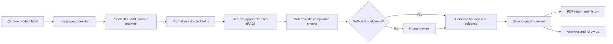
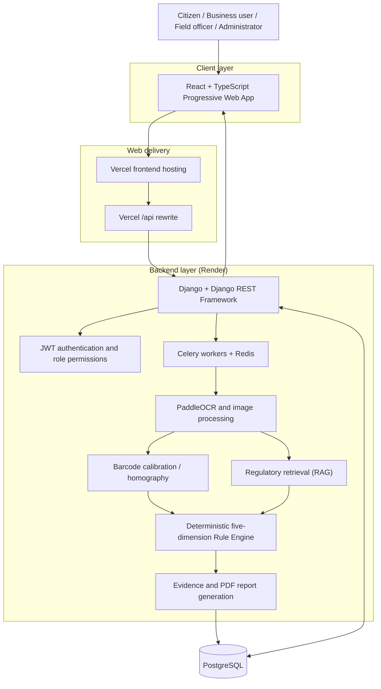
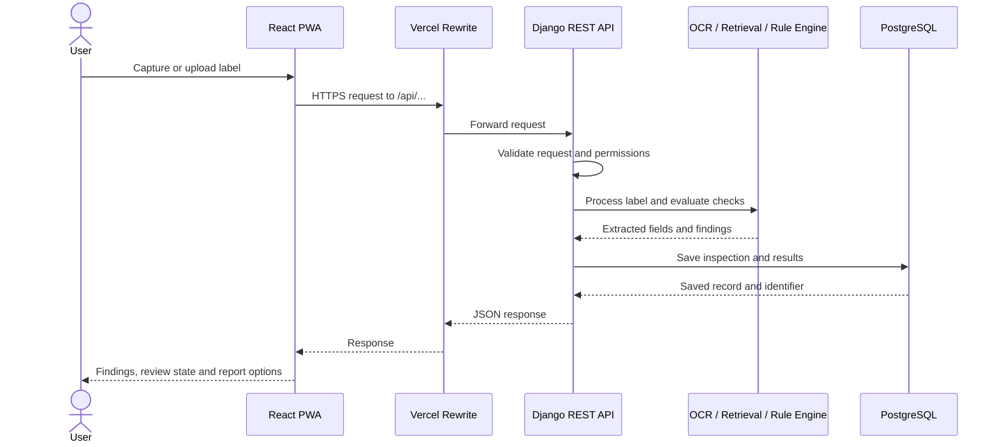

# PARAKH
### AI-Powered Product Label Compliance System

**Smart India Hackathon 2026 · Software · Problem Statement SIH26034 · Team Spark Crew (Team ID 126648)**

> **AI can detect a problem, but enforcement needs proof.**

Parakh checks packaged-product labels against the **Legal Metrology (Packaged Commodities) Rules, 2011** and its amendments. An officer scans a label. Parakh reads it with multilingual OCR, fetches the matching legal rule, runs five compliance checks, and produces an evidence-backed PDF report. Every inspection is saved, so repeat violations are easy to spot.

**Status:** prototype under active development for SIH 2026. Items listed under [Roadmap](#17-roadmap) are planned, not yet complete.

| Resource | Link |
|---|---|
| **Live platform** | **[Open Parakh](https://parakh-ai-seven.vercel.app)** |
| Backend API | [Django API on Render](https://parakh-backend-ar5z.onrender.com) |
| Demo video | [Watch the demonstration](https://docs.google.com/videos/d/1vn630M3nfeel2771lWLdAm69liC-rP7garPZPqLdOG0/edit?scene=id.p#scene=id.p) |

---

## Contents

1. [Problem Statement](#1-problem-statement)
2. [Proposed Solution](#2-proposed-solution)
3. [Screenshots](#3-screenshots)
4. [How Parakh Works](#4-how-parakh-works)
5. [Five-Dimensional Label Audit](#5-five-dimensional-label-audit)
6. [System Architecture](#6-system-architecture)
7. [API and Data Flow](#7-api-and-data-flow)
8. [AI and Compliance Pipeline](#8-ai-and-compliance-pipeline)
9. [Key Innovations](#9-key-innovations)
10. [Technology Stack](#10-technology-stack)
11. [Users and Workflows](#11-users-and-workflows)
12. [How Parakh Compares](#12-how-parakh-compares)
13. [Technical Challenges and Our Solutions](#13-technical-challenges-and-our-solutions)
14. [Impact and Evaluation Plan](#14-impact-and-evaluation-plan)
15. [Repository Structure, Setup and Deployment](#15-repository-structure-setup-and-deployment)
16. [Security, Limitations and Responsible Use](#16-security-limitations-and-responsible-use)
17. [Roadmap](#17-roadmap)
18. [Research and References](#18-research-and-references)
19. [Team](#19-team)

---

## 1. Problem Statement

**ID:** SIH26034 · **Theme:** Miscellaneous · **Category:** Software

**Title:** *Software System to check compliance of Packaged Commodities under Legal Metrology (Packaged Commodities) Rules, 2011 by scanning products, images and labels.*

Every packaged product must carry declarations that are present, readable, correctly formatted, placed in the right panel, and correct for the product type. Checking this by hand does not scale.

| Gap today | Why it hurts |
|---|---|
| **Manual inspection** | One officer, millions of products. |
| **No memory** | The system cannot tell a first-time violation from a repeat one. |
| **Outdated rules** | Laws change over time; tools do not keep up. |
| **No visibility** | The ministry cannot see nationwide trends. |
| **Weak evidence** | Findings are not linked to the image, field, measurement and rule behind them. |
| **Uncertain OCR** | A low-confidence read can wrongly become a legal violation. |

## 2. Proposed Solution

Parakh connects image-based label reading with legal rule checks and a traceable inspection record.

1. **Guided capture:** A **6-step** workflow helps the officer photograph the label correctly.
2. **Multilingual OCR:** **PaddleOCR** and image processing extract the label text.
3. **Barcode-calibrated measurement:** A barcode or declared pack size gives a real-world scale, so font height can be measured without a physical ruler.
4. **Rule retrieval (RAG):** Retrieval-Augmented Generation **(RAG)** finds the legal provisions that apply to this product.
5. **Deterministic Rule Engine:** Fixed, testable rules (not AI guesses) decide pass or fail.
6. **Evidence-backed PDF report:** Every finding links to its image, field, rule and officer review.
7. **Inspection history:** Each scan is stored, so repeat cases are identifiable.
8. **Admin dashboard:** Administrators add each new amendment, with its source and effective date.

**Design principle:** *OCR extracts, retrieval supplies the rule, deterministic checks decide.* Uncertain or legally sensitive cases go to a human reviewer.

## 3. Screenshots

**Technical approach: the 10-step Digital Enforcement Loop**

.png)

**Five-dimensional audit**


**Officer dashboard**


**Guided label capture and scan result**


**Evidence-backed PDF report**


**Admin Rule Engine dashboard**


## 4. How Parakh Works



**Step by step**

1. **Capture:** the officer photographs the label through the guided workflow.
2. **Preprocess:** images are prepared for text extraction and measurement.
3. **Extract:** OCR reads the visible text; barcode information helps calibrate size.
4. **Structure:** the text is organized into named fields (net quantity, price, date, and so on).
5. **Classify and retrieve:** the product category is identified and the matching legal provisions are fetched.
6. **Validate:** the Rule Engine runs the five audit checks.
7. **Review:** low-confidence fields go to an officer instead of being auto-flagged.
8. **Record:** the inspection, findings and evidence are stored.
9. **Report:** a PDF report and the product's history become available in the app.

## 5. Five-Dimensional Label Audit

| Dimension | What it checks |
|---|---|
| **Completeness Engine** | Every mandatory declaration is present on the label. |
| **Format Validator** | Values match the required date, price and quantity formats. |
| **Legibility Scanner** | Font height meets the minimum, measured on a barcode-calibrated scale. |
| **Placement Validator** | Each declaration sits in its legally required panel. |
| **Applicability Engine** | The correct rule set is applied for the product category and type. |

A check runs only when the evidence and the applicable rule are available. Missing or unreliable input is marked **needs review** or **not assessable**, never treated as proof of a violation.

## 6. System Architecture



OCR, calibration, retrieval and rule validation are modules inside the backend. They are independent, so each can be improved or scaled without rebuilding the rest.

| Component | Responsibility |
|---|---|
| React + TypeScript PWA | Capture inputs, guide the user, show findings, history and reports. |
| Vercel | Hosts the frontend and forwards `/api` requests to the backend. |
| Django + DRF | HTTP APIs, request validation, coordination of processing. |
| JWT + role permissions | Controls who can call which endpoint (citizen, officer, administrator). |
| Celery + Redis | Runs heavy processing (OCR, reports) in the background. |
| PaddleOCR | Reads multilingual label text from images. |
| Barcode / homography | Converts image pixels to real-world size for font-height checks. |
| RAG retrieval | Finds the legal provisions that apply to the product. |
| Rule Engine | Runs the five audit checks with fixed, testable logic. |
| PostgreSQL | Stores products, inspections, evidence, rule versions, findings and reports. |
| ReportLab | Builds the evidence-backed PDF report. |

### Core data model

Records are linked so any finding can be traced back to its inputs:

- **Product / brand :** Product identity and label information.
- **Inspection :** Identifier, time, status, officer, product.
- **Image / evidence :** Source image plus extracted or measured data.
- **Extracted field :** Normalized declaration, confidence, source reference.
- **Rule / rule version :** Clause, effective dates, applicability.
- **Finding :** Audit dimension, outcome, reason, evidence.
- **Officer action :** Review status, corrections, verification.
- **Report :** Generated PDF linked to its inspection.

## 7. API and Data Flow

The frontend calls the backend over HTTP using a relative path (`/api`). In production, Vercel forwards these requests to the Render backend, so the browser always sees one consistent API address.



Endpoints are defined in each Django app's `urls.py` and use Django REST Framework serializers. Protected endpoints require a JWT access token.

## 8. AI and Compliance Pipeline

**Multilingual OCR.** PaddleOCR reads text in multiple scripts. Accuracy depends on image quality, glare, curvature and print size, so the original image is kept next to every extracted value for easy verification.

**Barcode-assisted measurement.** When a barcode or a declared pack size is available, homography (a geometric mapping between the photo and the real flat surface) converts pixels to millimetres. Font height is then measured on that scale. Curved and glossy packs reduce reliability, so these measurements are confidence-scored.

**Regulatory retrieval (RAG).** The system searches a knowledge base built from the Legal Metrology (Packaged Commodities) Rules, 2011 and its amendments, and keeps the clause, rule version and effective date with each result. Retrieval supplies context; it is not itself a legal verdict.

**Deterministic Rule Engine.** Each check has defined inputs, an applicable rule version, fixed logic, and an explainable outcome: pass, potential issue, needs review, or not assessable. Fixed logic is easier to test and audit than free-form AI output.

**Uncertainty-aware review.** A low-confidence read, a missing reference, or an ambiguous interpretation is flagged for an officer. It is never turned into a violation automatically.

**Evidence-backed reports.** Each PDF links findings to the source image, extracted field, measurement, applicable rule and officer validation, and shows which values are machine-extracted and which an officer has verified.

## 9. Key Innovations

| Innovation | What it does |
|---|---|
| **Citizen → Officer loop** | Turns consumer complaints into actionable field-inspection requests. |
| **Evidence chain** | Links every verdict to its image, field, rule and officer validation. |
| **History-aware enforcement** | Separates first-time cases from repeat violations using inspection history. |
| **Rule simulation** | Tests a new regulation against historical scans before it is activated. |
| **Uncertainty-aware AI** | Flags ambiguous cases for a human instead of turning them into violations. |
| **Consumer intelligence** | Explains label checks in plain language for consumers. |
| **Rule Engine Admin Dashboard** | Lets administrators add each amendment with source, effective date and transition window. |

## 10. Technology Stack

| Layer | Technology |
|---|---|
| Frontend | React, Vite, TypeScript, Tailwind CSS |
| App type | Progressive Web App (PWA) via `vite-plugin-pwa` |
| Backend | Python, Django, Django REST Framework |
| Authentication | JWT (SimpleJWT), role-based access |
| Background jobs | Celery, Redis |
| OCR and vision | PaddleOCR, pyzbar (barcodes), homography calibration |
| Regulatory knowledge | Retrieval-Augmented Generation (RAG) |
| Compliance logic | Custom deterministic Rule Engine (five dimensions) |
| Database | PostgreSQL |
| PDF reports | ReportLab (Platypus) |
| Dev environment | Docker Compose, Git, GitHub |
| Hosting (free tier) | Vercel (frontend), Render (backend), Neon (PostgreSQL), Upstash (Redis) |

## 11. Users and Workflows

| User | What Parakh gives them |
|---|---|
| **Field officers** | Guided label checks, standard evidence, inspection records, PDF reports. |
| **Administrators** | Rule maintenance with versioning, inspection visibility, system control. |
| **Consumers** | Plain-language label information and a way to raise complaints. |
| **Businesses / sellers** | A pre-compliance check before distribution or listing. |
| **Authorities / policy teams** | Trends, repeat-offender patterns and category-level insights. |

## 12. How Parakh Compares

| Feature | **Parakh** | Smart Consumer (GS1 India) | BIS CARE | NCH / INGRAM App |
|---|:---:|:---:|:---:|:---:|
| Barcode / photo-based product scan | ✅ | ✅ | ✅ | ❌ |
| Verified label data (government rule engine, not brand self-upload) | ✅ | ❌ | ❌ | ❌ |
| Machine-verified font-size and declaration-placement checks | ✅ | ❌ | ❌ | ❌ |
| First-time vs. repeat violation history | ✅ | ❌ | ❌ | ❌ |
| Field officer inspection queue and case management | ✅ | ❌ | ❌ | ❌ |
| Risk-scored complaint routing to jurisdictional officer | ✅ | ❌ | ❌ | ✅ |
| Admin rule drafting, sandbox simulation and publishing | ✅ | ❌ | ❌ | ❌ |
| Unified multi-role dashboard (citizen + officer + admin) | ✅ | ❌ | ❌ | ❌ |

## 13. Technical Challenges and Our Solutions

| Challenge | Our solution |
|---|---|
| **Curved geometry :** Converting pixels to millimetres on curved, glossy packs is hard. | **Homography calibration** Using a reference marker or the declared size to compute real-world scale. |
| **Panel sizing :** Font rules depend on the panel area, not the whole packet. | **Declared pack size** is captured before font height is measured. |
| **Real-world labels :** Foil, curves and multilingual text break flat-image assumptions. | **Diverse test data:** Testing on real foil, curved and multilingual packaging. |
| **False positives :** A wrong non-compliance call has legal consequences. | **Confidence gating :** Low-confidence fields go to a human and are never auto-flagged. |

## 14. Impact and Evaluation Plan

Parakh aims to cut repetitive label reading, standardize evidence, support history-aware inspections, and give authorities visibility into compliance patterns. The figures below are **project targets, not measured results**.

| Measure | Target and how it will be evaluated |
|---|---|
| Label-field recognition | **≥95%** accuracy on a manually verified benchmark of representative labels. |
| Inspection time | **40–60% reduction** in manual verification time, checked with a before/after study. |
| Audit coverage | Every applicable label checked across all five dimensions. |
| Evidence linkage | Every verdict linked to its image, field, rule and review record. |
| Searchable history | All recorded inspections searchable, subject to retention rules. |
| Uncertain cases | Low-confidence fields correctly escalated to review. |
| Rule correctness | Rule outputs tested against manually reviewed cases and the correct effective rule version. |
| PDF reporting | Report success rate, missing evidence, officer correction rate. |

**Planned evaluation method**

1. Build a dataset of label images covering flat, curved, glossy and multilingual packaging.
2. Create manually verified ground truth for each field.
3. Measure field-level accuracy, precision and recall with clearly defined denominators.
4. Test every rule with positive, negative, boundary and not-assessable cases.
5. Record end-to-end inspection time with and without the app.
6. Audit evidence completeness and review escalation.
7. Publish dataset scope, test conditions and limitations next to any headline number.

For context, a published product-label OCR study reported **78% recognition accuracy** on its own dataset. That is external research, not a Parakh result, and the two may not be directly comparable.

## 15. Repository Structure, Setup and Deployment

### Repository structure

```text
repository-root/
├── backend/
│   ├── apps/                  # Django application modules
│   ├── config/                # Settings and URL configuration
│   ├── ml_services/           # OCR and related service modules
│   ├── manage.py
│   ├── requirements.txt
│   └── .env.example
├── frontend/
│   ├── src/
│   │   ├── features/          # Feature-based UI modules
│   │   └── services/          # API client and helpers
│   ├── public/
│   ├── package.json
│   └── vercel.json
├── docs/
│   └── images/                # Screenshots and diagrams used in this README
└── README.md
```

### Prerequisites

- Git
- Python 3.10 or newer
- Node.js 18 or newer, with npm
- PostgreSQL and Redis (Docker Compose can run both)

### Run locally

**1. Clone**

```bash
git clone https://github.com/pulkit-gupta-12/SIH-2026.git
cd SIH-2026
```

**2. Start the database and Redis**

```bash
docker compose up -d
```

**3. Backend**

```bash
cd backend
python -m venv .venv
```

Activate the virtual environment:

```powershell
# Windows PowerShell
.\.venv\Scripts\Activate.ps1
```

```bash
# macOS / Linux
source .venv/bin/activate
```

Then install, configure and run:

```bash
pip install -r requirements.txt
cp .env.example .env        # then fill in your local values
python manage.py migrate
python manage.py runserver
```

The API runs at `http://127.0.0.1:8000/`.

**4. Frontend** (in a second terminal)

```bash
cd frontend
npm install
npm run dev
```

Open the local URL that Vite prints in the terminal.

### Environment configuration

Copy `.env.example` to `.env` and keep secrets out of Git.

| Variable type | Purpose |
|---|---|
| Django secret key | Cryptographic secret for the app. |
| Debug / allowed hosts | Environment-specific Django behaviour and host checks. |
| Database URL | Connection to PostgreSQL. |
| Redis URL | Connection used by Celery. |
| JWT settings | Token lifetimes and authentication options. |
| CORS / CSRF trusted origins | Approved frontend domains. |
| Frontend API base URL | Which backend the frontend talks to. |

### Deployment

| Part | Platform |
|---|---|
| Frontend | Vercel (forwards `/api` to the backend through a rewrite) |
| Backend | Render: `https://parakh-backend-ar5z.onrender.com` |
| Database | PostgreSQL on Neon |
| Redis | Upstash |

Free-tier backends can sleep when idle, so the first request after a pause may take a little longer.

## 16. Security, Limitations and Responsible Use

- **Human in the loop:** Parakh assists officers. Automated findings support, and do not replace, authorized human verification for legally consequential decisions.
- **Image limits:** glare, blur, small print, curved packaging and unusual scripts can reduce OCR and measurement reliability.
- **Measurement assumptions:** calibration depends on a correct reference size and suitable geometry.
- **Regulatory accuracy:** every rule is tied to its source, product category, version and effective date. Amendments follow a controlled review and publishing process.
- **Evidence integrity:** source images, extracted fields, rule versions, results and officer actions stay linked.
- **Privacy:** only necessary data is collected; access to images and inspection records is restricted.
- **Access control:** admin and officer actions are enforced on the server through role-based permissions.
- **Deployment hygiene:** HTTPS, secrets kept in the hosting provider, validated uploads, safe error handling.
- **Scope:** Parakh supports inspection workflows. It does not replace the governing law or the enforcement authority.

## 17. Roadmap

- Test across more product categories, packaging materials and Indian languages.
- Improve calibration and legibility measurement for curved and reflective packs.
- Strengthen rule simulation and amendment review workflows.
- Expand citizen complaint routing and jurisdiction-aware officer assignment.
- Deepen history-based risk analysis and national dashboards.
- Extend the Progressive Web App into a native mobile app.
- Publish a reproducible benchmark for extraction accuracy, rule correctness, review escalation and end-to-end time.

## 18. Research and References

1. **Department of Consumer Affairs: Legal Metrology Act and Rules** — https://consumeraffairs.gov.in/pages/legal-metrology-act
2. **Department of Consumer Affairs: Legal Metrology Overview** — https://consumeraffairs.gov.in/pages/legal-metrology-overview
3. **Nagayi et al. (2025):** *Evaluating OCR Performance on Food Packaging Labels* — https://arxiv.org/abs/2510.03570
4. **Kumar et al. (2023):** *Real-Time Automated Detection of Errors in Product Labels Using Image Processing and OCR* — https://ieeexplore.ieee.org/abstract/document/10390320
5. **FSSAI:** *Labelling and Display Regulations, 2020* — https://fssai.gov.in/upload/uploadfiles/files/Compendium_Labelling_Display_04_01_2022.pdf
6. **Department of Consumer Affairs: Annual Reports** — https://consumeraffairs.gov.in/pages/annual-report

Research figures belong to their original studies and are not Parakh's own results. Always verify the latest official rules and amendments.

## 19. Team

**Team Spark Crew** · Team ID 126648 · Smart India Hackathon 2026 · Problem Statement SIH26034

| Name | Role | Contribution |
|---|---|---|
| Pulkit Gupta | Team Leader | Backend + PPT |
| Kanishk Doosaj | Team Member | OCR + Database |
| Shweta | Team Member | Research |
| Darshana Sharma | Team Member | Research |
| Ritik Kriplani | Team Member | Frontend |
| Yash Kabra | Team Member | Frontend |

---

**Parakh is not just an OCR tool. It connects AI extraction, rule-based validation, history, evidence and enforcement into one system.**